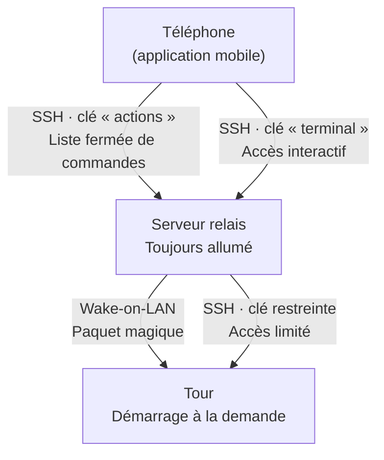

# homelab-control

Application mobile et scripts pour piloter un petit homelab depuis un téléphone :
allumer et éteindre une tour, suivre l'état des machines, ouvrir un terminal.

> **Statut : phase 3 en cours.** Depuis un terminal, par SSH : allumer,
> éteindre et redémarrer la tour, programmer son allumage, suivre son état et
> son extinction automatique. L'application Android fait la même chose avec
> des boutons (à valider sur le téléphone).

## Ce que fera le projet

- Allumer la tour à distance (Wake-on-LAN), l'éteindre, la redémarrer, programmer son allumage
- Extinction automatique de la tour : échéance prolongeable, bouton « ne pas éteindre », plafond absolu, jamais pendant qu'on l'utilise
- Surveillance du serveur et de la tour : processeur, mémoire, températures, disques (SMART), services
- Tableau de bord sécurité et journal de toutes les actions
- Terminal SSH vers chaque machine
- Webcam, sans aucun port exposé (passage par un tunnel SSH)

## Architecture

## Architecture




Principes :

- **Un seul transport : SSH.** Pas d'API web, pas de base de données, pas de nouveau port ouvert.
- **La ligne de commande d'abord.** Chaque fonction marche depuis un terminal avant d'exister dans l'application.
- **Moindre privilège.** La clé « actions » ne peut lancer qu'une liste fermée de commandes, la clé « terminal » est séparée, et les droits administrateur sont limités au strict nécessaire.
- **Code public, configuration privée.** Aucun secret ni identifiant personnel dans le dépôt : chaque installation garde ses valeurs dans un fichier local.

## Organisation du dépôt

```
homelab-control/
├── app/        Application Android (Flutter)
├── common/     Bibliothèque commune au serveur et à la tour
├── server/     Scripts et services du serveur
├── tower/      Scripts et services de la tour
├── config/     Modèles de configuration, avec des valeurs fictives
├── docs/       Feuille de route et modèle de sécurité
├── scripts/    Vérifications avant publication et installation des hooks
└── .githooks/  Hooks Git versionnés (avant commit, message, avant push)
```

## Démarrer

```bash
git clone <adresse-du-dépôt>
cd homelab-control
scripts/install-hooks.sh   # active les verrous de publication (une fois par clone)
```

La configuration de chaque machine part du modèle `config/homelab.conf.example`,
copié hors du dépôt dans `/etc/homelab/homelab.conf`.

## Documentation

- [`docs/PLAN.md`](docs/PLAN.md) : feuille de route, fonctionnalités et choix techniques
- [`docs/SECURITY.md`](docs/SECURITY.md) : modèle de sécurité et règles de publication
- [`server/README.md`](server/README.md) : installation du serveur, actions, allumage programmé
- [`tower/README.md`](tower/README.md) : installation de la tour, extinction automatique
- [`app/README.md`](app/README.md) : construction et installation de l'application

## Licence

[MIT](LICENSE)
