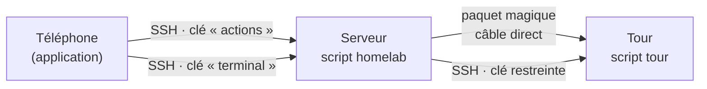

# Feuille de route

## Objectif

Piloter depuis un téléphone un homelab composé de deux machines :

- un **serveur** toujours allumé, qui sert de point d'entrée ;
- une **tour**, puissante, allumée seulement quand on en a besoin.

## Principes

1. **Un seul transport : SSH.** Le téléphone n'utilise que SSH. Pas d'API web, pas de base de données, pas de service supplémentaire, pas de nouveau port.
2. **La ligne de commande d'abord.** Chaque action est un script, testable depuis un terminal. L'application n'est qu'une télécommande : si elle tombe en panne, tout reste faisable à la main.
3. **Moindre privilège.** Chaque clé et chaque compte n'a que les droits dont il a besoin.
4. **Pas de couche sans besoin réel.** Un composant n'est ajouté que s'il règle un problème constaté.
5. **Code public, configuration privée.** Le dépôt doit pouvoir être publié sans aucun risque (voir [`SECURITY.md`](SECURITY.md)).

## Architecture



- Le téléphone ne parle qu'au serveur, toujours joignable, qui relaie vers la tour.
- **Clé « actions »** : elle appartient à un compte dédié, `homelab`, sans mot de passe ni droits d'administrateur, et elle est liée à une commande forcée. Quoi qu'on envoie, seul le script `homelab` s'exécute, et il n'accepte qu'une liste fermée d'actions. Les actions qui demandent les droits root (réveil, lecture des disques et des journaux, redémarrage d'un service autorisé) passent par un petit script autorisé par `sudo` avec des arguments fixes.
- **Clé « terminal »** : accès complet, protégée dans l'application par l'empreinte digitale à chaque utilisation.
- Le serveur se connecte à la tour avec une clé elle aussi restreinte au script `tour`, et les droits administrateur de la tour sont limités par `sudoers` aux seules commandes nécessaires.

## Fonctionnalités retenues

| Fonctionnalité | Phase |
|---|---|
| Allumer la tour (Wake-on-LAN par le câble direct) | 1 |
| Éteindre et redémarrer la tour | 1-2 |
| Temps depuis l'allumage, temps restant avant extinction | 2 |
| Extinction automatique : échéance par défaut, « prolonger », « éteindre dans N minutes », plafond absolu | 2 |
| Durée selon l'allumage (4 h par le serveur, 8 h à la main = le plafond), prolongation d'une durée au choix | 4 |
| Bouton « ne pas éteindre » temporaire, dans la limite du plafond | 2 |
| Jamais d'extinction automatique pendant qu'on utilise la tour : session ouverte, mise à jour, tâche protégée par `systemd-inhibit` | 2 |
| Allumage programmé (dates au format systemd, dans la configuration du serveur) | 2 |
| Journal de toutes les actions | 1 |
| Surveillance du serveur et de la tour : processeur, mémoire, températures, réseau (câble, signal Wi-Fi) | 4 |
| Santé des disques (SMART) | 4 |
| État des services, avec redémarrage d'un service autorisé | 4 |
| Tableau de bord sécurité : dernières connexions SSH, refus du pare-feu | 4 |
| Terminal vers le serveur et la tour | 5 |
| Webcam via un tunnel SSH, sans port exposé | 6 |
| Affichage des allumages programmés et du prochain allumage | 6 |

## Écarté, et pourquoi

| Idée | Raison |
|---|---|
| Mises à jour de la tour depuis l'application | Une mise à jour qui échoue à distance peut rendre la tour injoignable : elles se font devant la machine |
| Notifications par un service extérieur | Pas de dépendance à un service tiers |
| Modifier l'allumage programmé depuis l'application | Il faudrait donner au téléphone le droit d'écrire une configuration lue par root : les dates se changent sur le serveur |
| API web, base de données | Surface d'attaque supplémentaire, sans besoin réel : SSH suffit |

## Phases

Chaque phase a un critère de fin vérifiable.

| Phase | Contenu | Critère de fin |
|---|---|---|
| **0** ✅ | Squelette du dépôt, verrous de publication | Un commit contenant une donnée de la liste noire, une adresse MAC ou une clé est bloqué |
| **1** ✅ | Script `homelab` sur le serveur : compte dédié, actions `status`, `wake`, `log`, état en JSON, journal (voir [`server/README.md`](../server/README.md)) | Depuis un terminal du téléphone : allumer la tour, lire l'état, consulter le journal |
| **2** ✅ | Script `tour`, extinction automatique (repoussée tant que la tour est utilisée), relais du serveur vers la tour (câble, puis VPN en secours), allumage programmé, `sudoers` limité (voir [`tower/README.md`](../tower/README.md)) | La tour s'éteint seule à l'échéance, même si le serveur et le téléphone sont hors ligne |
| **3** 🚧 | Application minimale : verrou (empreinte ou code), clé SSH créée sur le téléphone, vérification de la clé du serveur, tableau de bord, boutons principaux, journal (voir [`app/README.md`](../app/README.md)) | Allumer, éteindre et prolonger depuis l'application |
| **4** 🚧 | Surveillance complète : disques (SMART), services avec redémarrage des services autorisés, sécurité, signal Wi-Fi ; durée de l'extinction selon l'allumage, prolongation au choix | Tous les indicateurs visibles dans l'application |
| **5** 🚧 | Terminal intégré, vers le serveur et vers la tour (en passant par le serveur), avec une clé séparée | Session interactive vers chaque machine depuis l'application |
| **6** 🚧 | Webcam par tunnel SSH, affichage des allumages programmés | Flux visible, serveur vidéo en écoute locale uniquement |

🚧 = code écrit ; la partie machines est testée, l'application reste à valider sur le téléphone.

## Contrat d'échange (première version)

Le script `homelab` répond par une ligne JSON. Toute réponse contient `ok` ; en cas d'échec, `error` (code stable) et `message` (texte lisible). Exemple de réponse à `status`, avec des valeurs fictives :

```json
{
  "ok": true,
  "api": 1,
  "time": "2026-01-01T12:00:00+01:00",
  "server": {
    "uptime_s": 345600,
    "load": [0.08, 0.12, 0.10],
    "cpu_pct": 2.3,
    "mem_used_pct": 21.4,
    "temp_c": 41.0,
    "disk_used_pct": 12,
    "battery_pct": 64,
    "on_ac": true,
    "wifi": { "iface": "wlan0", "signal_dbm": -58 }
  },
  "link": { "present": true, "carrier": true },
  "tower": { "online": false, "via": null, "detail": null }
}
```

- `api` permet de faire évoluer le format sans casser l'application.
- Quand la tour est allumée, `tower.detail` contient la réponse de son propre script : temps depuis le démarrage, températures, échéance d'extinction (exemple complet dans [`server/README.md`](../server/README.md)).
- Une mesure indisponible vaut `null`, jamais une valeur inventée.

Codes de sortie : 0 = ok, 1 = échec, 2 = commande refusée.

## Choix techniques

| Rôle | Choix | Pourquoi |
|---|---|---|
| Application | Flutter | Une seule base de code, interface native |
| SSH et transfert de fichiers | dartssh2 | Client SSH en Dart pur, avec SFTP |
| Terminal | xterm.dart | Émulateur de terminal complet, prévu pour dartssh2 |
| Verrou de l'application | local_auth, flutter_secure_storage | Empreinte digitale ; stockage chiffré en AES-GCM, clé protégée par le Keystore d'Android |
| Côté machines | Bash, systemd, sudoers, `authorized_keys` | Rien à installer, rien de nouveau qui tourne en permanence |

## Points à vérifier pendant le développement

- Clé SSH de l'application : créée sur le téléphone, gardée dans le stockage chiffré (clé de chiffrement protégée par le Keystore). Possible amélioration : un stockage déchiffrable seulement après l'empreinte elle-même (`AndroidOptions.biometric` de flutter_secure_storage 11), à essayer sur le téléphone avant de l'adopter.
- Valeurs de l'extinction automatique (8 h à la main, 4 h par le serveur, +2 h, plafond de 8 h, délai de 30 min devant la tour) : réglables dans la configuration.
- Détection du verrouillage de l'écran par KDE (`LockedHint`) : à vérifier une fois sur la tour (procédure dans [`tower/README.md`](../tower/README.md#à-vérifier-une-fois-sur-la-tour)).
