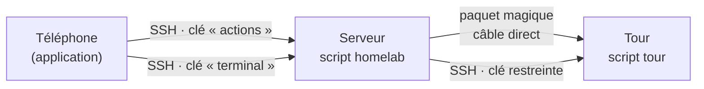

# Feuille de route

## Objectif

Piloter depuis un téléphone un homelab composé de deux machines :

- un **serveur** toujours allumé, qui sert de point d'entrée ;
- une **tour**, puissante, allumée seulement quand on en a besoin.

## Principes

1. **Un seul transport : SSH.** Le téléphone n'utilise que SSH. Pas d'API web, pas de base de données, pas de service supplémentaire, pas de nouveau port.
2. **La ligne de commande d'abord.** Chaque action est un script, testable depuis un terminal. L'application n'est qu'une télécommande : si elle tombe en panne, tout reste faisable à la main.
3. **Moindre privilège.** Chaque clé et chaque compte n'a que les droits dont il a besoin.
4. **Pas de couche sans besoin réel.** Un composant n'est ajouté que s'il règle un problème constaté.
5. **Code public, configuration privée.** Le dépôt doit pouvoir être publié sans aucun risque (voir [`SECURITY.md`](SECURITY.md)).

## Architecture



- Le téléphone ne parle qu'au serveur, toujours joignable, qui relaie vers la tour.
- **Clé « actions »** : dans `authorized_keys`, elle est liée à une commande forcée. Quoi qu'on envoie, seul le script `homelab` s'exécute, et il n'accepte qu'une liste fermée d'actions.
- **Clé « terminal »** : accès complet, protégée dans l'application par l'empreinte digitale à chaque utilisation.
- Le serveur se connecte à la tour avec une clé elle aussi restreinte au script `tour`, et les droits administrateur de la tour sont limités par `sudoers` aux seules commandes nécessaires.

## Fonctionnalités retenues

| Fonctionnalité | Phase |
|---|---|
| Allumer la tour (Wake-on-LAN par le câble direct) | 1 |
| Éteindre et redémarrer la tour | 1-2 |
| Temps depuis l'allumage, temps restant avant extinction | 2 |
| Extinction automatique : échéance par défaut, « prolonger », plafond absolu | 2 |
| Bouton « ne pas éteindre » temporaire, dans la limite du plafond | 2 |
| Allumage programmé, géré par le serveur | 2 |
| Journal de toutes les actions | 1 |
| Surveillance du serveur et de la tour : processeur, mémoire, températures, réseau | 4 |
| Santé des disques (SMART) | 4 |
| État des services, avec redémarrage d'un service autorisé | 4 |
| Tableau de bord sécurité : dernières connexions SSH, refus du pare-feu | 4 |
| Terminal vers le serveur et la tour | 5 |
| Webcam via un tunnel SSH, sans port exposé | 6 |

## Écarté, et pourquoi

| Idée | Raison |
|---|---|
| Mises à jour de la tour depuis l'application | Une mise à jour qui échoue à distance peut rendre la tour injoignable : elles se font devant la machine |
| Notifications par un service extérieur | Pas de dépendance à un service tiers |
| API web, base de données | Surface d'attaque supplémentaire, sans besoin réel : SSH suffit |

## Phases

Chaque phase a un critère de fin vérifiable.

| Phase | Contenu | Critère de fin |
|---|---|---|
| **0** | Squelette du dépôt, verrous de publication | Un commit contenant une donnée de la liste noire, une adresse MAC ou une clé est bloqué |
| **1** | Script `homelab` sur le serveur : actions, état en JSON, journal | Depuis un terminal du téléphone : allumer la tour, lire l'état, consulter le journal |
| **2** | Script `tour`, extinction automatique, `sudoers` limité | La tour s'éteint seule à l'échéance, même si le serveur et le téléphone sont hors ligne |
| **3** | Application minimale : verrou biométrique, tableau de bord, boutons principaux | Allumer, éteindre et prolonger depuis l'application |
| **4** | Surveillance complète : disques, services, sécurité | Tous les indicateurs visibles dans l'application |
| **5** | Terminal intégré | Session interactive vers chaque machine depuis l'application |
| **6** | Webcam par tunnel SSH, écran de programmation | Flux visible, serveur vidéo en écoute locale uniquement |

## Contrat d'échange (première version)

Le script `homelab` répond en JSON. Exemple de réponse à `status`, avec des valeurs fictives :

```json
{
  "version": 1,
  "server": {
    "uptime_s": 345600,
    "cpu_pct": 4.2,
    "mem_used_pct": 21.0,
    "temp_c": 41.0
  },
  "tower": {
    "online": true,
    "uptime_s": 5400,
    "auto_off": {
      "deadline": "2026-01-01T22:00:00+01:00",
      "remaining_s": 7200,
      "hold": false
    }
  }
}
```

Le champ `version` permet de faire évoluer le format sans casser l'application.

## Choix techniques

| Rôle | Choix | Pourquoi |
|---|---|---|
| Application | Flutter | Une seule base de code, interface native |
| SSH et transfert de fichiers | dartssh2 | Client SSH en Dart pur, avec SFTP |
| Terminal | xterm.dart | Émulateur de terminal complet, prévu pour dartssh2 |
| Verrou de l'application | local_auth, flutter_secure_storage | Empreinte digitale et stockage chiffré d'Android |
| Côté machines | Bash, systemd, sudoers, `authorized_keys` | Rien à installer, rien de nouveau qui tourne en permanence |

## Points à vérifier pendant le développement

- Stockage des clés SSH dans la puce de sécurité du téléphone (StrongBox) : compatibilité avec dartssh2 à confirmer. Solution de repli : clé chiffrée par un code, avec une dérivation résistante aux essais en masse.
- Valeurs de l'extinction automatique (8 h, +2 h, plafond de 48 h) : réglables dans la configuration.
